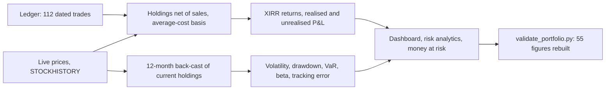
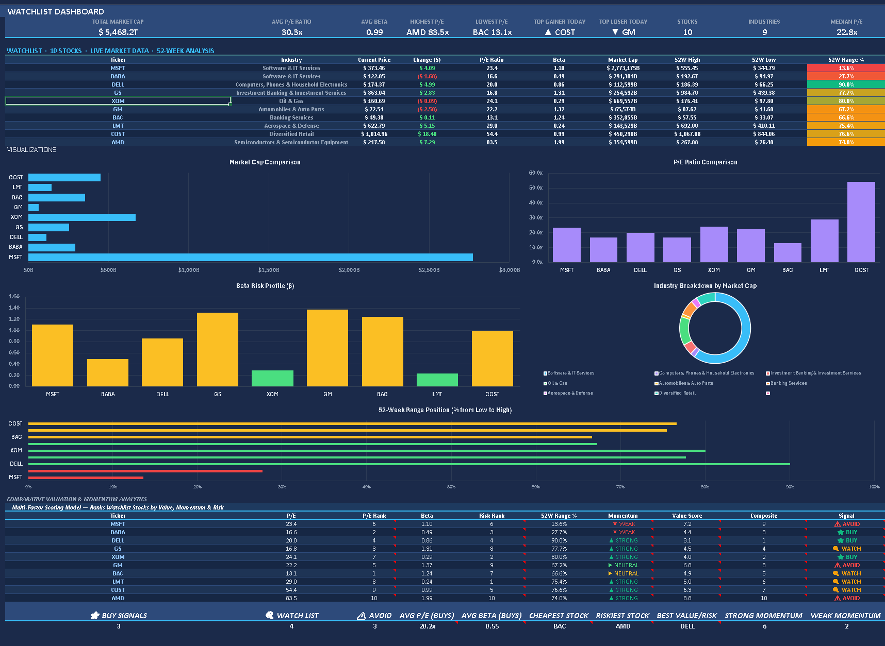

# Stock Portfolio Risk Tracker

32.2% a year since 2019, with 62% of the money in one sector.

| At a glance | |
|---|---|
| **Who decides** | An investor deciding whether to trim a winning position. |
| **Result** | 62% of the $211,335 portfolio sits in semiconductors, so a 30% fall in that sector would cost about $39,500. |
| **Proof** | 112 dated trades in 16 stocks, 55 calculated figures rebuilt outside Excel by a Python validator, 25 tests (15 corrupt the workbook on purpose). |

[](LICENSE)
[](https://www.microsoft.com/en-us/microsoft-365/excel)
[](https://github.com/alvenyuka/Stock-Portfolio-Tracker-Analytics-Engine/actions/workflows/ci.yml)


## The problem

Headline returns from a broker statement ignore when money went in and out, and say nothing about
concentration. An investor deciding whether to trim a winning position needs the return actually earned on
the money invested, the loss the portfolio could take in dollars, and the tax cost of reducing that risk. The
question: **how much of this portfolio's strong return is one bet, and what would it cost to reduce it?**

## How it works



1. **Accounting.** Units held = bought minus sold; cost basis at average purchase price; realised P&L booked on
   each sale.
2. **Returns.** XIRR over dated purchases and sales with the value on the valuation date as the final cash flow,
   per holding and for the portfolio. One input cell (`ValuationDate`) ends every IRR and price window, so the
   figures reproduce until that date is changed.
3. **Risk.** Today's holdings valued daily over 12 months give volatility, downside deviation, drawdown,
   historical VaR, and beta, tracking error and information ratio against SPY; CAPM, Sharpe, Sortino, Calmar and
   M-squared use them, and a money-at-risk block on the Risk Analytics sheet turns them into dollars.
4. **Rebalancing.** `scenarios.py` rebalances the current holdings under three policies and measures each with
   the validator's own arithmetic.
5. **Independent check.** The workbook carries 26 in-sheet tests, including units reconciling to the ledger;
   `validate_portfolio.py` then rebuilds all 55 calculated figures from the ledger, prices and inputs.

## Stack

| Layer | Tool | Version |
|---|---|---|
| Workbook | Excel 365: Stocks data type, `STOCKHISTORY`, dynamic arrays, XIRR; no VBA or add-ins | |
| Validator and scenarios | Python, openpyxl | openpyxl 3.1 or later |
| Charts | matplotlib | 3.7 or later |
| BI report | Power BI Desktop project (`.pbip`, TMDL semantic model with DAX measures) reading CSVs exported from the workbook | |
| Tests and CI | pytest with fault injection, GitHub Actions | Python 3.13 in CI |

## Results

An Excel 365 tracker that turns 112 dated trades in 16 stocks into money-weighted returns, 12-month risk analytics and money at risk, with a Python validator that rebuilds all 55 calculated figures outside Excel. The portfolio has returned 32.2% a year since 2019, but 62% of its $211,335 sits in semiconductors, so a 30% fall in that sector would cost about $39,500. 25 tests, 15 of them corrupting the workbook on purpose, prove the checks catch errors.

- 112 trades (80 buys, 32 sells) from 2019 to 2025; 16 holdings across 10 sectors; 251 trading days of prices.
- 55 calculated figures rebuilt outside Excel; 26 in-sheet tests; 25 Python tests (18 for the validator, 15 of
  which corrupt the workbook on purpose, and 7 for the scenarios).

| Measure (valued 29 Sep 2026) | Value |
|---|---:|
| Market value | $211,335 |
| Annual return since 2019, money-weighted (XIRR) | **32.2%** |
| Total gain, realised and unrealised | $183,363 |
| 12-month return vs SPY | 35.7% vs 15.4% |
| Volatility / maximum drawdown, 12 months | 26.0% / -14.8% |
| Sharpe ratio (12 months) | 1.21 |
| Beta vs SPY / tracking error | 1.64 / 16.9% |

The risk-adjusted numbers are good, but the dispersion is wide. A Sharpe ratio of 1.21 sits alongside a 14.8%
drawdown and a 16.9% tracking error, and a beta of 1.64 means the portfolio amplifies market moves, so it can
diverge sharply from SPY in either direction.

## Business impact

The portfolio's exposure in money terms, as printed by `validate_portfolio.py`:

| Exposure (valued 29 Sep 2026) | Amount |
|---|---:|
| 1-day loss not exceeded on 95% of days (historical VaR) | $5,645 |
| Worst peak-to-trough fall of current holdings, last 12 months | $25,279 |
| Largest holding, NVIDIA (45.1% of value) | $95,286 |
| Semiconductors (62.3% of value) | $131,600 |
| Loss if semiconductors fell 30% | **$39,480**, 18.7% of the portfolio |

With an effective number of holdings of about 4, a 30% semiconductor fall would take out nearly a fifth of the
portfolio, seven times the loss the 1-day VaR puts on an ordinary bad day. What reducing it would cost and buy
(`scenarios.py`; sold value is spread over the other holdings in proportion to their value; 15% tax on net
realised gains and 0.10% trading cost on the value traded):

| Policy | Current | NVIDIA capped at 25% | No holding above 20% | Semiconductors capped at 40% |
|---|---:|---:|---:|---:|
| Largest holding / semiconductors | 45.1% / 62.3% | 25.0% / 48.5% | 20.0% / 40.0% | 29.0% / 40.0% |
| Effective number of holdings | 4.1 | 7.0 | 8.7 | 7.6 |
| Loss if semiconductors fell 30% | $39,480 | $30,730 | $25,360 | $25,360 |
| 1-day VaR (95%) | $5,645 | $4,591 | $4,312 | $4,189 |
| Volatility / beta vs SPY (12-month back-cast) | 26.0% / 1.64 | 23.3% / 1.55 | 21.0% / 1.44 | 20.0% / 1.37 |
| Value sold | 0 | $42,452 | $53,019 | $47,066 |
| One-off cost: tax + trading | 0 | $6,131 | $7,657 | $6,723 |

Capping semiconductors at 40% buys the most risk reduction per dollar: about $6,700 of tax and costs removes
$14,120 from the semiconductor-shock loss and brings volatility down to 20%. Capping NVIDIA alone costs about
$6,100 and removes $8,750, because the money sold out of NVIDIA partly flows into AMD, the other semiconductor
holding. Most of every cost is tax: NVIDIA was bought at an average of $11.57 against a price of $228.86, so
trimming it realises a large gain. Over the last 12 months the semiconductor cap would have earned 26.5% against
35.7% for the current mix; the choice is a judgement about how much of the semiconductor bet to keep.

## Charts


*One sector holds most of the money.*


*Each policy's risk reduction against what it costs in tax and trading.*


*The concentrated mix beat the market over the year, with wider swings.*



*The watchlist screens 10 stocks on valuation and momentum (AMD is also a holding).*

## Data

| Input | Source | Size | Period | Refresh |
|---|---|---:|---|---|
| Trade ledger | paper portfolio, in the workbook | 112 trades | 2019 to 2025, dated 1 January each year | static |
| Current prices | Excel's Stocks data type | 16 holdings, 10 watchlist stocks | valuation date 29 Sep 2026 | Data, Refresh All |
| Price history | `STOCKHISTORY` | 251 trading days of closes | 12 months to the valuation date | Data, Refresh All |
| Benchmark | SPY via `STOCKHISTORY` | same 12 months | same | same |

RTX's London listing (2.1% of value) has no price history and is left out of the 12-month series.

## Key design decisions

- **Money-weighted returns, not time-weighted.** XIRR over the dated trades measures what the investor's own
  money earned, including when it went in and out.
- **One valuation-date cell.** Every IRR and price window ends at `ValuationDate`, so the figures reproduce
  exactly until that date is changed.
- **Risk in dollars, not only ratios.** VaR, drawdown and a sector shock are restated as money at risk, which is
  what a decision to trim a position is weighed against.
- **Checked from outside Excel.** An independent review of an earlier version found sales being added to
  positions instead of netted; the accounting was rebuilt, every figure restated, and the validator now checks
  each one. Building it also caught Excel's XIRR returning a silent 0% for Boeing when it failed to converge;
  the workbook now shows an error instead of a false zero (Boeing has lost 13.6% a year).
- **Scenarios held to the workbook.** The unchanged portfolio in `scenarios.py` reproduces the workbook's
  figures exactly, and a test holds it to that, so the policy comparisons use the same arithmetic.

## Limits

- **Paper portfolio.** Trades are hypothetical and dated 1 January each year (a nominal date, not a trading
  day); fees and taxes on past trades are not modelled.
- **Cost basis pools every purchase of a stock.** A running average, which the validator prints alongside,
  gives realised P&L of $15,686 rather than $14,944; total gain is the same under both.
- **Back-cast risk.** The 12-month figures value today's holdings historically, which describes current
  exposure rather than the returns actually earned over that year.
- **The sector shock is a scenario, not a forecast**, and applies one shock to the whole sector.
- **Rebalancing costs rest on two assumptions** (15% tax on net realised gains, 0.10% trading cost); both are
  constants at the top of `scenarios.py`, to be set to the investor's own.

## Project structure

```
Stock Portfolio.xlsx      the workbook: ledger, dashboard, analytics, risk, price history, portfolio series,
                          watchlist, validation
validate_portfolio.py     independent validator: 55 figures rebuilt, money at risk
scenarios.py              rebalancing policies: money at risk, concentration and the tax cost of each
make_figures.py           README charts drawn from the workbook's stored values
export_powerbi_data.py    writes powerbi-data/ (holdings, sectors, ledger, KPIs) from the workbook for Power BI
StockPortfolio.pbip       Power BI report: KPI cards, return by stock, sector donut, holdings table
StockPortfolio.SemanticModel/, StockPortfolio.Report/   its semantic model and report definition
figures/                  charts and dashboard screenshots
tests/                    18 validator tests (15 inject a fault), 7 for the scenarios
docs/METHODOLOGY.md       every definition and the review history
```

## How to run

```bash
pip install -r requirements.txt
python validate_portfolio.py      # rebuild every figure and print the money at risk
python -m pytest                  # prove the validator catches injected faults
python scenarios.py               # price the rebalancing policies (writes outputs/scenarios.json)
python make_figures.py            # redraw the README charts
```

Open `Stock Portfolio.xlsx` in Excel 365 and run Data, Refresh All for live prices.

For the Power BI report: run `python export_powerbi_data.py` after saving the workbook, open
`StockPortfolio.pbip` in Power BI Desktop, set the `DataFolder` parameter (Transform data, Edit parameters) to
this clone's `powerbi-data\` folder, and refresh. The export stops if the holdings do not sum to the
dashboard's market value, so the report always shows the workbook's figures.

## Skills demonstrated

- Trade-ledger accounting with average-cost basis and realised P&L: the workbook
- Money-weighted returns with XIRR, per holding and for the portfolio: the workbook
- Risk analytics: volatility, drawdown, historical VaR, beta, tracking error, Sharpe, Sortino: the Risk Analytics sheet
- Concentration and stress analysis in dollars: `validate_portfolio.py`
- Rebalancing policy comparison with tax and trading costs: `scenarios.py`
- Independent validation and fault-injection testing of a spreadsheet: `validate_portfolio.py`, `tests/`
- A Power BI semantic model and report fed from the same validated figures: `StockPortfolio.pbip`, `export_powerbi_data.py`

## License

MIT. See [`LICENSE`](LICENSE).

Alven Yuka · [LinkedIn](https://www.linkedin.com/in/alven-yuka-610b78174/) · [Email](mailto:alvenyuka2@gmail.com)
