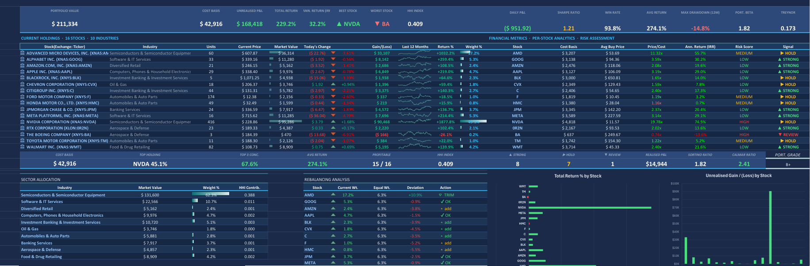
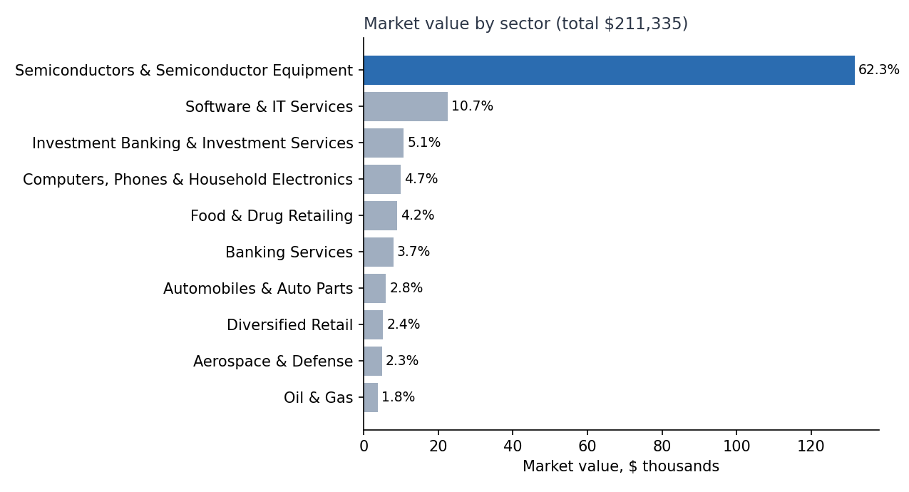
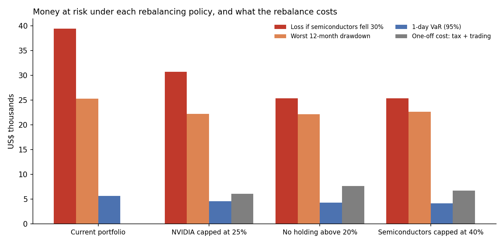
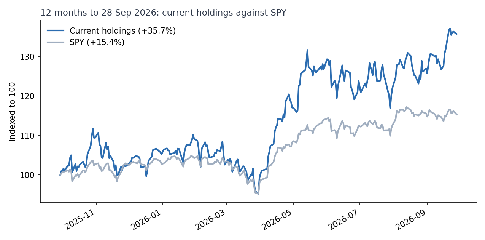

# Stock Portfolio Tracker

An Excel workbook that tracks a 16-stock portfolio from its trades, a Python script that recomputes every calculated figure to check it, and a Power BI report on the same numbers.

[](LICENSE)
[](https://www.microsoft.com/en-us/microsoft-365/excel)
[](https://github.com/alvenyuka/Stock-Portfolio-Tracker-Analytics-Engine/actions/workflows/ci.yml)



## What this project does

An investor who has held winners for years has to decide whether to sell some. A broker statement shows the total gain but not when money went in and out, and not how much of the portfolio rides on one idea. A wrong call is expensive either way: sell too much and you pay tax on the gain, sell too little and one sector can wipe out a large share of the portfolio.

The project answers one question: **how much of this portfolio's return is one bet, and what would it cost to reduce it?**

It has three parts:

- **The workbook** (`Stock Portfolio.xlsx`, Excel 365) holds the list of buys and sells (the ledger), current prices and 12 months of price history. From these it works out holdings, profit and loss, returns and risk measures.
- **The validator** (`validate_portfolio.py`) is a Python script that rebuilds the workbook's 55 calculated figures from the raw inputs and flags any that disagree. Tests break a copy of the workbook on purpose to prove the validator notices.
- **The Power BI report** (`StockPortfolio.pbip`) shows the same figures, read from CSVs that `export_powerbi_data.py` writes from the workbook.

Data: a paper (hypothetical) portfolio of 112 dated trades (80 buys, 32 sells) in 16 stocks, 2019 to 2025, valued on 29 September 2026. Prices come from Excel's own stock data feed.

## Results

- **Value and return.** The portfolio is worth $211,335. Its money-weighted annual return since 2019 (IRR, the single yearly rate that makes the dated cash in and out add up to today's value) is 32.2%. Total gain (realised plus unrealised) is $183,363.
- **One sector holds most of the money.** Semiconductors are 62.3% of the value ($131,600). NVIDIA alone is 45.1% ($95,286).
- **What a bad month in that sector costs.** If semiconductors fell 30%, the portfolio would lose $39,480, which is 18.7% of its value.
- **Risk-adjusted return.** The Sharpe ratio (return above the risk-free rate, divided by volatility, so higher means more return per unit of ups and downs) over the last 12 months is 1.21. Over the same 12 months the portfolio's current holdings returned 35.7% against 15.4% for the SPY index fund, with a 26.0% volatility and a worst peak-to-trough fall of 14.8%.
- **Checks.** The validator re-derived 55 of 55 figures and all 25 tests pass.

| Exposure (valued 29 Sep 2026) | Amount |
|---|---:|
| Loss if semiconductors fell 30% | $39,480 |
| Worst peak-to-trough fall of today's holdings, last 12 months | $25,279 |
| Loss on a bad day (1-day value at risk, 95%: the loss not exceeded on 95% of days) | $5,645 |

Source: the "Money at risk" block printed by `validate_portfolio.py`.

What it would cost to reduce the risk, from `scenarios.py` (written to `outputs/scenarios.json`). The assumptions: money from sold shares is spread over the other holdings in proportion to their value, tax is 15% of net realised gains, and trading cost is 0.10% of the value traded.

| Policy | Semiconductors share | Loss if semis fell 30% | Value sold | Tax and trading cost |
|---|---:|---:|---:|---:|
| Current | 62.3% | $39,480 | 0 | 0 |
| NVIDIA capped at 25% | 48.5% | $30,730 | $42,452 | $6,131 |
| No holding above 20% | 40.0% | $25,360 | $53,019 | $7,657 |
| Semiconductors capped at 40% | 40.0% | $25,360 | $47,066 | $6,723 |

Capping semiconductors at 40% cuts the shock loss by $14,120 for $6,723. Capping NVIDIA alone cuts it by $8,750 for $6,131, because part of the money sold flows into AMD, the other semiconductor holding. Most of the cost is tax, since NVIDIA was bought at an average of $11.57 and trades at $228.86. Over the last 12 months the semiconductor cap would have returned 26.5% against 35.7% for the current mix, so the choice is a judgement about how much of the bet to keep.



*One sector holds most of the money.*

## How I built it

1. **Record the trades.** The ledger sheet in `Stock Portfolio.xlsx` lists every buy and sell with date, price and units. Everything else is calculated from it.
2. **Work out what is held.** Units held are units bought minus units sold. Cost basis (what the shares you still hold cost you) uses the average purchase price, and a sale books a realised gain or loss (profit actually locked in). The first version added sales to holdings instead of subtracting them, see Problems.
3. **Measure returns that respect timing.** IRR (defined above) is calculated with Excel's `XIRR` for each stock and for the whole portfolio. A single `ValuationDate` cell ends every return and price window, so the figures stay the same until that date is changed.
4. **Measure risk from prices.** A "Portfolio Series" sheet values today's holdings on each of 251 trading days. From that series come volatility (how much the daily value swings, per year), maximum drawdown (the biggest fall from a peak), value at risk (defined above), beta against SPY (how strongly the portfolio moves with the market) and the Sharpe ratio (defined above).
5. **Turn risk into dollars.** `validate_portfolio.py` restates the largest sector, the largest holding and the 30% sector shock as money, which is what a decision to sell is weighed against.
6. **Check it from outside Excel.** `validate_portfolio.py` rebuilds all 55 calculated figures from the ledger, prices and inputs using only raw cells, and prints PASS or FAIL for each.
7. **Test the checker.** In 14 of the 18 tests in `tests/test_validate_portfolio.py`, the test copies the workbook, damages one stored value and asserts that exact figure is reported as wrong. `tests/xlsx_surgery.py` does the damage by editing the sheet XML directly, because saving through openpyxl would discard every stored result.
8. **Price the fixes.** `scenarios.py` rebalances today's holdings under three policies and measures each with the validator's own arithmetic. `tests/test_scenarios.py` (7 tests) holds the unchanged portfolio to the workbook's figures.
9. **Draw the charts.** `make_figures.py` plots the README charts from the workbook's stored values.
10. **Build the report.** `export_powerbi_data.py` writes the four CSVs in `powerbi-data/` from the workbook and stops if the holdings do not add up to the dashboard's market value. `StockPortfolio.pbip` reads them.



*Each policy's drop in shock loss against what it costs in tax and trading.*



*The concentrated mix beat the market over the year, with wider swings.*

## Problems I hit

- **Sales were added to holdings.** An earlier version summed all units, buys and sells together, so the portfolio showed $302,909 instead of $211,335 and every weight, return and ratio was wrong. An independent review of the workbook found it. The ledger now nets sales, and the validator has a test (`test_sales_added_instead_of_netted_is_caught`) that reintroduces the mistake and checks it is caught (commit `d7707ed`).
- **Excel's XIRR returned 0% for Boeing.** When XIRR fails to converge it can show zero, so a holding losing 13.6% a year looked flat. XIRR now gets a starting guess and shows an error instead of a false zero (`d7707ed`).
- **Annual return was a fixed seven-year CAGR.** Purchases made in 2025 were treated as held since 2019. Replaced by IRR over the dated trades.
- **Other formula slips.** The same review also found GOOG's price row reading AMZN's prices, two different Sortino figures under one name (37.2 and 2.6), and volatility taken as beta times a typed number instead of measured. All are listed in `docs/METHODOLOGY.md` with their fixes.
- **The Power BI report was started before these fixes.** It was kept out of git as work in progress on 28 September, a day before the ledger fix, and committed on 18 October with its CSVs rebuilt by `export_powerbi_data.py` from the corrected workbook. Its value, IRR and Sharpe cards read from `powerbi-data/KPIs.csv`.

## Data

| Input | Source | Size | Period |
|---|---|---|---|
| Trade ledger | Paper portfolio kept in the workbook | 112 trades (80 buys, 32 sells) | 2019 to 2025, each dated 1 January |
| Current prices | Excel's Stocks data type | 16 holdings | Valuation date 29 Sep 2026 |
| Price history | `STOCKHISTORY`, including SPY as the benchmark | 251 trading days | 12 months to the valuation date |

Prices refresh with Data, Refresh All in Excel 365. RTX's London listing (2.1% of value) has no price history and is left out of the 12-month series, so those figures cover 15 of 16 holdings.

## Limits

- The trades are hypothetical and dated 1 January each year, which is a nominal date, not a trading day. Fees and taxes on past trades are not modelled.
- The workbook pools every purchase of a stock into one average cost. A running average gives realised gain of $15,686 instead of $14,944. Total gain is the same either way.
- The 12-month risk figures value today's holdings back through the year. They describe current exposure, not what the account earned over that year.
- The 30% sector fall is a scenario, not a forecast, and applies one shock to the whole sector.
- The rebalancing costs rest on the 15% tax and 0.10% trading cost assumptions. Both are constants at the top of `scenarios.py` and should be set to the investor's own.

## How to run

Needs Python 3 with `openpyxl`, `matplotlib` and `pytest`. Excel 365 is needed to refresh prices; the validator reads the stored values and does not need Excel.

```bash
pip install -r requirements.txt
python validate_portfolio.py      # rebuild all 55 figures, print the money at risk
python -m pytest                  # 25 tests (about 2.5 minutes)
python scenarios.py               # price the rebalancing policies, writes outputs/scenarios.json
python make_figures.py            # redraw the charts
python export_powerbi_data.py     # after saving the workbook; writes powerbi-data/
```

For the Power BI report, open `StockPortfolio.pbip` in Power BI Desktop, set the `DataFolder` parameter (Transform data, Edit parameters) to this clone's `powerbi-data\` folder, and refresh.

## Project structure

```
Stock Portfolio.xlsx      the workbook: ledger, dashboard, analytics, risk, price history, watchlist
validate_portfolio.py     rebuilds 55 figures from raw inputs, prints money at risk
scenarios.py              rebalancing policies and their tax and trading cost
make_figures.py           README charts
export_powerbi_data.py    writes powerbi-data/ for the report
StockPortfolio.pbip       Power BI project (with StockPortfolio.SemanticModel/ and StockPortfolio.Report/)
tests/                    18 validator tests, 7 scenario tests
figures/                  charts and dashboard screenshots
docs/METHODOLOGY.md       every definition and the review history
```

## License

MIT. See [LICENSE](LICENSE).

Alven Yuka · [LinkedIn](https://www.linkedin.com/in/alven-yuka-610b78174/) · [Email](mailto:alvenyuka2@gmail.com)
